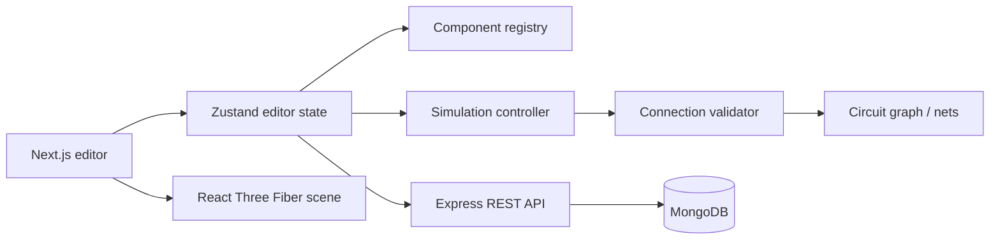

# Circuit Studio

Circuit Studio is an interactive 3D circuit designer for a deliberately bounded ESP32 demonstration: a DHT22 environmental sensor and a resistor-protected status LED on a solderless breadboard. It is designed for circuit exploration, not as a SPICE solver or firmware emulator.

## Features

- React Three Fiber workbench with orbit, pan, zoom, selection, translation, rotation, and live wire endpoints.
- Pin-level connections backed by structured `{ componentId, pinId }` references.
- Breadboard terminal-strip and continuous power-rail net resolution.
- Electrical validation for invalid pin references, no-connect pins, duplicated wires, disconnected DHT22 wiring, incomplete LED circuits, and direct 3V3-to-GND shorts.
- Modular simulation controller for ESP32 GPIO modes/states, a 220 Ω series LED circuit, and application-level DHT22 readings.
- Sensor environment controls, GPIO controls, diagnostics, event logs, start/stop/reset.
- MongoDB project persistence: create, list, load, update, delete, export/import, and unguessable-token public read-only sharing.
- A checked-in [sample project](./sample-project.json) named **ESP32 Smart Home Monitoring System**.

## Technology

- Frontend: Next.js App Router, React, TypeScript, Zustand, Three.js, React Three Fiber, Drei.
- Backend: Node.js, Express, TypeScript, MongoDB, Mongoose.

## Architecture



The editor layout is independent from simulation state. Three.js reads components and connections from Zustand; the simulation controller reads the same structured data, evaluates nets and diagnostics, and returns display state without depending on rendering.

### Main modules

- `client/src/lib/componentRegistry.ts` defines supported component metadata, pin definitions, physical dimensions, default properties, and specs.
- `client/src/engine/CircuitGraph.ts` resolves wires, breadboard strips/rails, and resistor continuity.
- `client/src/engine/connectionValidator.ts` produces structured diagnostics.
- `client/src/engine/simulationEngine.ts` evaluates the supported ESP32, LED, and DHT22 model.
- `client/src/store/circuitStore.ts` owns editable state, read-only shared-project behavior, and the simulation lifecycle.
- `server/src/validation/projectValidation.ts` protects persistence against malformed projects.

## Supported simulation model

| Component | Supported behavior |
| --- | --- |
| ESP32 DevKit | GPIO2/GPIO4/GPIO5 INPUT or OUTPUT state controls; GPIO2 drives the LED demonstration when OUTPUT. |
| DHT22 | Requires 3V3, GND, and a configurable data GPIO (GPIO4 by default); exposes configurable °C and % readings. |
| LED | Illuminates only with GPIO2 HIGH, an idealized series-resistor path to its anode, and a cathode-to-GND path. |
| Resistor | Provides idealized continuity and validates a positive resistance; 220 Ω is the starter value. |
| Breadboard | Left/right split terminal-strip groups per row and continuous positive/negative rails. |

The DHT22 uses an application-level data model; real single-wire timing is intentionally not claimed. Analog behavior, arbitrary digital ICs, real firmware execution, current limits, and full SPICE analysis are outside this project’s scope.

## Run locally

### Prerequisites

- Node.js 20 or newer
- MongoDB locally or a MongoDB Atlas database

### API

```bash
cd server
cp .env.example .env
# Set MONGODB_URI in .env to your own database connection string.
npm install
npm run dev
```

`server/.env`:

```dotenv
MONGODB_URI=mongodb://127.0.0.1:27017/circuit-studio
PORT=8000
CLIENT_URL=http://localhost:3000
```

The health check is `GET http://localhost:8000/health`.

### Web client

```bash
cd client
cp .env.example .env.local
npm install
npm run dev
```

Open [http://localhost:3000](http://localhost:3000). `NEXT_PUBLIC_API_URL` defaults to `http://localhost:8000/api`.

## Demonstration walkthrough

1. Open `/editor`; the verified **ESP32 Smart Home Monitoring System** is loaded.
2. Start simulation. The DHT22 reports the configured temperature and humidity through the breadboard rails.
3. Set GPIO2 to OUTPUT/HIGH. The LED turns on only because GPIO2 → 220 Ω resistor → breadboard strip → LED anode and LED cathode → GND are connected.
4. Change the environment values in the console and observe the readings update.
5. Click a wire to remove it, then run again to see the corresponding diagnostic and the LED or DHT22 fail safely.
6. Save to MongoDB, reload through **Open**, export JSON, or generate a public read-only share link.

The same circuit can be imported from [sample-project.json](./sample-project.json).

## API

| Method | Endpoint | Purpose |
| --- | --- | --- |
| `GET` | `/health` | API/database health |
| `GET` | `/api/projects` | List projects |
| `POST` | `/api/projects` | Create a project |
| `GET` | `/api/projects/:id` | Load a project |
| `PUT` | `/api/projects/:id` | Update a project |
| `DELETE` | `/api/projects/:id` | Delete a project |
| `POST` | `/api/projects/:id/share` | Create or rotate a public share token |
| `GET` | `/api/shared/:token` | Load a public read-only project |

A persisted project includes `schemaVersion`, name/description, components, positions/rotations, properties, connections, GPIO simulation settings, and timestamps. The server validates component identifiers, supported types, numeric transforms, scalar properties, connection references, and GPIO setting shapes before saving.

## Verification

```bash
# deterministic simulation checks
cd client
../server/node_modules/.bin/tsx scripts/verify-simulation.ts
npm run lint
npx tsc --noEmit

# backend request-payload validation tests
cd ../server
npm test

# production builds
cd ../client && npm run build
cd ../server && npm run build
```

The simulation check validates the starter net, a disconnected LED, and a power-to-ground short. Browser interaction should also be checked manually when changing Three.js scene controls.

## Deployment

Deploy the Next.js client and Express API as separate services.

1. Host the API (for example on Render) with `npm install` and `npm start` from `server/`.
2. Configure `MONGODB_URI`, `PORT`, and `CLIENT_URL` in the API environment.
3. Deploy `client/` to a Next.js host and set `NEXT_PUBLIC_API_URL` to the API’s `/api` URL.
4. Update `CLIENT_URL` to the frontend origin so production CORS permits it.
5. Verify `/health`, project save/load, and a generated public share URL after deployment.

No deployment credentials are present in this repository, so no live deployment URL or demonstration video is claimed. Record the walkthrough above after deployment if a video deliverable is required.

## Future improvements

- Undo/redo history for editor operations.
- More components (buttons, switches, OLEDs, motors) with explicitly documented simulation support.
- A limited ESP32-like code interpreter.
- Per-user authentication and project ownership for persisted projects.
- E2E browser tests with a real MongoDB test instance.
